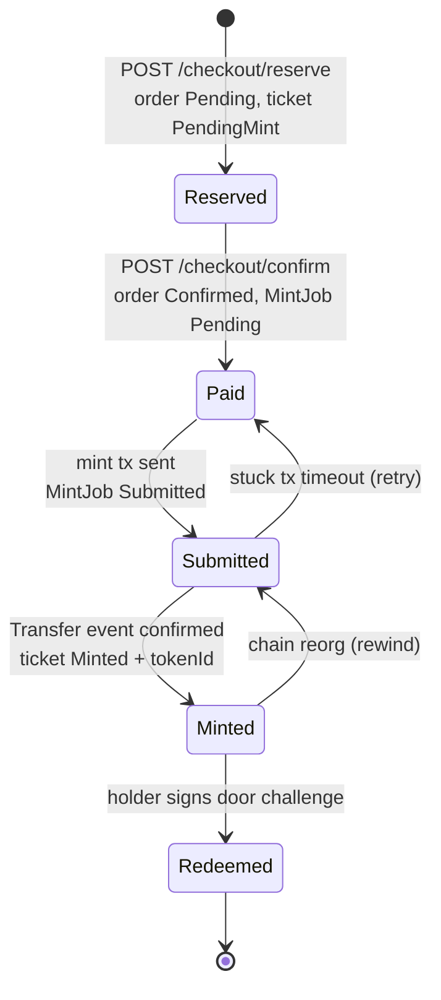
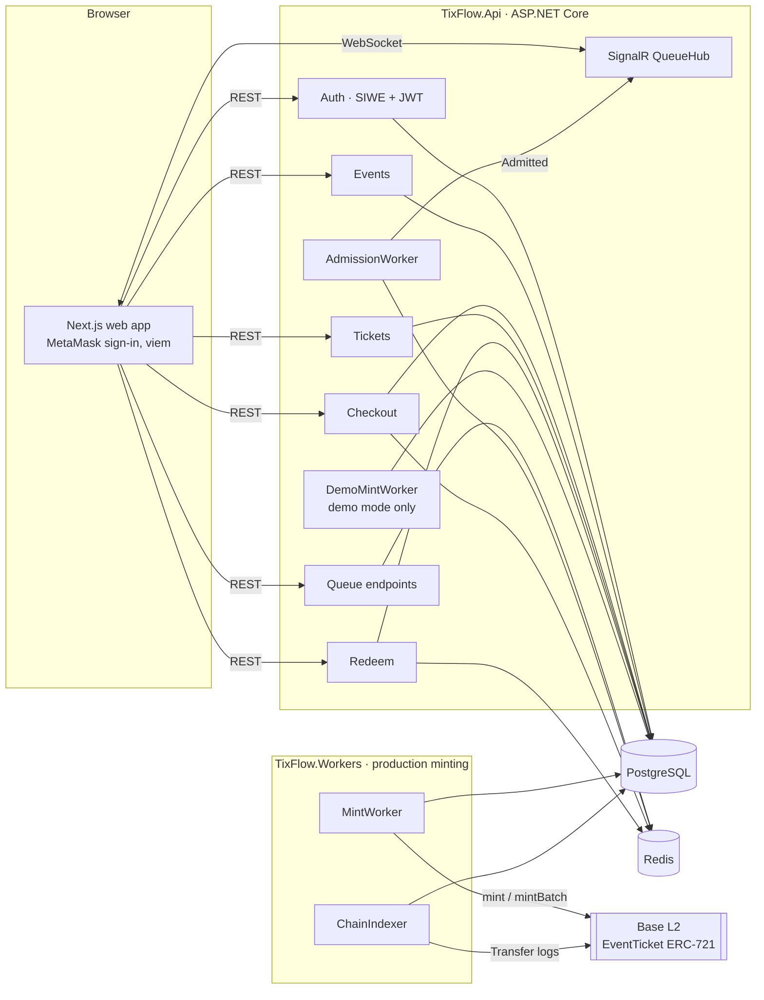
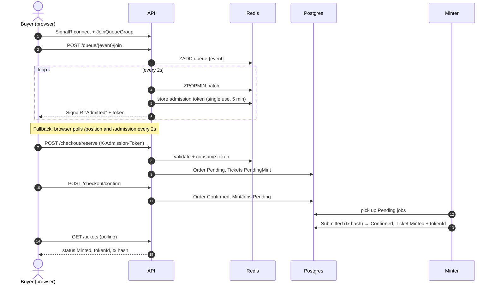

# TixFlow

**Fair-queue event ticketing with NFT tickets on Base L2.**

TixFlow sells tickets the way a sold-out drop should work: buyers wait in a fair first-come queue instead of fighting bots, check out inside a short admission window, and receive an ERC-721 ticket on Base. At the door, the holder proves ownership by signing a one-time challenge, so screenshots and copied QR codes don't get anyone in.

The project runs fully offline in **demo mode**: buyers sign in with MetaMask using a signature only (no funds and no network needed), payments are simulated, and NFT minting is simulated by the API so the whole flow completes in seconds without a blockchain connection.


---

## Contents

- [Quick start (Docker)](#quick-start-docker)
- [The user flow](#the-user-flow)
- [Architecture](#architecture)
- [On-chain protocol](#on-chain-protocol)
- [Tech stack](#tech-stack)
- [Running the project](#running-the-project)
- [Demo events](#demo-events)
- [Working with the database and Redis](#working-with-the-database-and-redis)
- [API reference](#api-reference)
- [Configuration](#configuration)
- [Testing and load testing](#testing-and-load-testing)
- [Project structure](#project-structure)
- [Troubleshooting](#troubleshooting)

---

## Quick start (Docker)

Requires [Docker Desktop](https://www.docker.com/products/docker-desktop/) (or Docker Engine with Compose v2).

```bash
git clone <repo-url> base-ticketing
cd base-ticketing
docker compose up --build
```

Open **http://localhost:3000** and click **Connect MetaMask** to sign in as a buyer, or **Use the Admin account** / **Use the Staff account** for the two built-in demo roles. Seven demo events are already listed.

| Service    | URL / address                  |
|------------|--------------------------------|
| Web app    | http://localhost:3000          |
| API        | http://localhost:5222          |
| OpenAPI    | http://localhost:5222/openapi/v1.json |
| PostgreSQL | `localhost:5432` (user `tixflow`, password `tixflow_dev`, db `tixflow`) |
| Redis      | `localhost:6379`               |

On first start the API applies database migrations and seeds the demo events automatically. Stop with `Ctrl+C`, or `docker compose down`. To wipe all data and start fresh, run `docker compose down -v`.

---

## The user flow

A complete demo takes about two minutes:

1. **Sign in.** Click **Connect MetaMask** and sign the Sign-In with Ethereum (SIWE) message. It is a signature, not a transaction, so the wallet needs no funds. A wallet's first sign-in gives it the **User** (buyer) role.
2. **Create an event (optional).** Click **Use the Admin account**, open **Admin → Manage events → New event**, fill in the name, venue, date and ticket tiers, and click **Publish event**.
3. **Join the queue.** As a buyer, open an event and click **Join the queue**. Your position updates live over SignalR. When your batch is admitted you're taken straight to checkout.
4. **Reserve.** Choose a tier and quantity (up to 4) before the 5-minute admission window closes, then click **Reserve**.
5. **Pay.** Click **Pay … ETH**. Payment is simulated in demo mode.
6. **Watch it mint.** The checkout page shows the mint transaction being sent and confirmed. After a few seconds your NFT ticket appears with a token number and QR code. It also shows up under **My tickets**.
7. **Check in at the door.** Click **Use the Staff account** and open **Door scanner**. Scan the QR code (or pick the ticket from the list if you have no camera), choose the holder's wallet and click **Sign & verify**. A green **Admitted** screen confirms entry. Scan the same ticket again, or sign with a different wallet, to see **Denied**.
8. **Check the dashboards.** As Admin, **Manage events** shows tickets sold, check-ins and revenue per tier, refreshing every few seconds. The **Admin** page grants and revokes roles, assigns staff to events and shows the audit log.

### Roles

| Role | How a wallet gets it | What it can do |
|------|----------------------|----------------|
| **User** | Automatically, on first sign-in | Join queues, buy tickets, see its own tickets |
| **Staff** | Granted by an admin (optionally limited to specific events) | Door scanner and the live check-in board |
| **Admin** | Listed in `Auth:AdminWallets` on the server | Create and cancel events, grant and revoke roles, assign staff, read the audit log |

Every endpoint checks the role on the server, and roles are re-read from the database on each request, so a change takes effect immediately. The page-level gates in the web app are only a courtesy.

### Ticket lifecycle



---

## Architecture



| Component | Responsibility |
|-----------|----------------|
| **Web app** (`src/frontend/web`) | Buyer, admin and door-scanner UI. Signs SIWE logins and door challenges through MetaMask (or viem for the local demo accounts) and listens for queue updates over SignalR. |
| **Auth** | Issues single-use nonces, verifies SIWE signatures (EIP-4361 + EIP-191), finds or creates the user by wallet address, and returns a 24-hour JWT. |
| **Queue + AdmissionWorker** | Each event has a Redis sorted set scored by join time. Every 2 seconds the worker pops the next batch (50 by default), issues each user a signed **admission token** (JWT, 5-minute TTL, single use) and pushes it over SignalR. Joining is rate-limited to 5 requests per 10 seconds per user. |
| **Checkout** | `reserve` sits behind `AdmissionGateFilter`, which validates the admission token, checks that it belongs to the caller, and marks it consumed in Redis. It also checks the tier, the quantity and the remaining supply. `confirm` marks the order paid and creates one `MintJob` per ticket. |
| **Redeem** | Two-step check-in: the API issues a random challenge (stored in Redis for 60 seconds), the holder signs it, and the API recovers the signer and compares it to the ticket owner's wallet. |
| **PostgreSQL** | Source of truth for users, events, tiers, orders, tickets, mint jobs and the indexer checkpoint (EF Core migrations). |
| **Redis** | Queue sorted sets, admission tokens, redemption challenges. |
| **TixFlow.Workers** | Production minting: sends mint transactions and indexes confirmations from Base. Not used in demo mode. |
| **Contracts** (`src/contracts`) | `EventTicket` (ERC-721, owner-only `mint`, `mintBatch`, `redeem`) and `PriceCappedResale` (resale capped at 10% above face value). Built with Foundry. |

### Purchase sequence



---

## On-chain protocol

ASP.NET Core is the checkout system; Base is the receipt and settlement layer. A purchase is confirmed in
Postgres in milliseconds and never waits for the chain. Everything that must not depend on trusting
TixFlow is enforced by contracts in [`src/contracts`](src/contracts) (Solidity 0.8.24, OpenZeppelin v5).

| Contract | Purpose | Key security properties |
|----------|---------|-------------------------|
| `TicketFactory` | Deploys one `EventTicket` per event as an EIP-1167 minimal proxy at a deterministic address | An event can only be deployed once; creating an event costs about 760k gas, against 3.9M just to deploy the bytecode once more (83% less per event) |
| `EventTicket` | ERC-721 tickets for one event: tiers, supply caps, per-wallet limits, transfer lock, ERC-2981 royalties, fully on-chain SVG metadata | Limits are enforced in the contract, so calling it directly gains nothing; tickets move only through the capped marketplace until the event ends; redeemed tickets are soulbound |
| `EventEscrow` | Holds primary-sale USDC until the event ends | The organizer is paid only after `eventEnd`; if the event is cancelled every holder can pull a full refund; nobody, including TixFlow, can withdraw to themselves |
| `PriceCappedResale` | Escrowed secondary market | Price can never exceed face value plus 10% (hard ceiling 50%); royalty and payment settle atomically with the transfer |
| `TicketRenderer` | Renders token metadata and artwork on-chain | No server or IPFS needed; names are escaped |
| `SignatureValidator` | ERC-1271 / ERC-6492 signature checks | Lets Coinbase Smart Wallet users sign in |

Roles use `AccessControlDefaultAdminRules` (two-step, delayed admin transfer): `MINTER_ROLE` and
`REDEEMER_ROLE` for the backend relayer, `PAUSER_ROLE` for emergencies, and `CANCELLER_ROLE` on the
escrow. See [THREAT_MODEL.md](THREAT_MODEL.md) for what each key can and cannot do if it leaks.

### How a purchase settles

1. **Checkout (off-chain, instant).** At "Pay" the buyer's wallet signs an EIP-3009
   `receiveWithAuthorization` for the order total, payable only to the escrow. Signing is local and
   costs no gas. `/checkout/confirm` stores the signature with the order and returns.
2. **Settlement (on-chain, asynchronous).** The mint worker signs an EIP-712 **mint voucher** for the
   order and calls `EventEscrow.purchaseWithAuthorization`. In one transaction the USDC moves from the
   buyer into escrow and the tickets are minted to the buyer.
3. **Indexing.** The indexer reads the `Minted` log, matches it to the order by its nonce, and records
   token IDs. The chain, not the database, is the source of truth for what was minted.

Every order has one nonce (its ID as a 128-bit number) that both mint paths burn, so an order can never
be minted twice.

**Your purchase is provable even if our worker is down.** `GET /orders/{id}/voucher` returns the signed
voucher. The checkout page's "Mint it myself" button submits it from the buyer's own wallet. When the
worker comes back it sees the nonce is used and skips the order.

### Proof of attendance

Door entry is decided off-chain by a signed challenge and never waits for the chain. Afterwards the
worker publishes a Merkle root of all redeemed tickets (`checkpointRedemptions`) and relays
`claimAttendanceBadge` for each holder. The ticket then becomes a soulbound badge: its on-chain artwork
changes and it can never be transferred again.

### Smart wallets

Sign-in accepts ordinary wallet signatures offline. If that check fails and a chain is configured, the
backend asks `SignatureValidator` through a read-only call, which covers deployed smart wallets
(ERC-1271) and not-yet-deployed ones (ERC-6492). A paymaster is not built yet; see the roadmap.

### Simulated mode

With `Chain:Enabled=false` the app runs with no chain at all: `DemoMintWorker` marks tickets as minted
after a few seconds and assigns sequential token numbers. The banner says **Demo mode**. This is what
you get from a plain `dotnet run` without Anvil.

### Wallets and demo accounts

Buyers connect MetaMask (`src/frontend/web/src/lib/metamask.ts`). The app only ever asks for message
signatures: the SIWE login and the one-time door challenge.

For local demos the API can also hand out two ready-made accounts, Admin and Staff, when
`Demo:ExposeAccounts` is `true`. Their keys live in `appsettings.Development.json` under `Demo:Accounts`;
the web app imports them with one click and keeps them in `localStorage`. **They are test keys for demos
only: never send real funds to them, and keep `Demo:ExposeAccounts` off on anything public.**

### Running with a local chain

```bash
# 1. Databases and a local chain
docker compose up -d postgres redis
docker run -d --name tixflow-anvil -p 8545:8545 ghcr.io/foundry-rs/foundry:stable "anvil --host 0.0.0.0 --block-time 1"

# 2. Deploy the protocol (the keys below are Anvil's public development keys: local use only)
cd src/contracts && sh script/install-deps.sh
PRIVATE_KEY=0xac0974bec39a17e36ba4a6b4d238ff944bacb478cbed5efcae784d7bf4f2ff80 \
MINTER_ADDRESS=0x70997970C51812dc3A010C7d01b50e0d17dc79C8 \
VOUCHER_SIGNER_ADDRESS=0x3C44CdDdB6a900fa2b585dd299e03d12FA4293BC \
forge script script/Deploy.s.sol:Deploy --rpc-url http://localhost:8545 --broadcast

# 3. API with the chain workers (same Anvil development keys)
cd ../backend/TixFlow/TixFlow.Api
Chain__Enabled=true Chain__DeploymentsFile=../../../contracts/deployments/local.json \
Chain__RelayerPrivateKey=0x59c6995e998f97a5a0044966f0945389dc9e86dae88c7a8412f4603b6b78690d \
Chain__VoucherSignerPrivateKey=0x5de4111afa1a4b94908f83103eb1f1706367c2e68ca870fc3fb9a804cdab365a \
Chain__Faucet__Enabled=true Indexer__ConfirmationBlocks=1 Database__MigrateOnStartup=true \
dotnet run --launch-profile http

# 4. Web app, then the end-to-end check that verifies every step on-chain
cd ../../../frontend/web && npm install && npm run dev
node scripts/e2e-chain.mjs
```

## Tech stack

| Layer | Technology |
|-------|------------|
| Frontend | Next.js 16 (App Router, Turbopack), React 19, TypeScript, Tailwind CSS 4 |
| Wallet and crypto (web) | viem (key generation and EIP-191 signing), SIWE message format |
| Realtime | ASP.NET Core SignalR + `@microsoft/signalr` client |
| QR codes | `qrcode.react` (render), `html5-qrcode` (camera scanning) |
| Backend API | ASP.NET Core 10 minimal APIs, JWT bearer auth, built-in rate limiter, OpenAPI |
| Data | PostgreSQL 16 with EF Core 10 (Npgsql), Redis 7 with StackExchange.Redis |
| Ethereum (.NET) | Nethereum (signature recovery, contract calls, log indexing) |
| Smart contracts | Solidity, Foundry, OpenZeppelin ERC-721 |
| Chain | Base L2 (chain ID 8453 / Base Sepolia for testing) |
| Testing | xUnit + `WebApplicationFactory` (36 integration tests), k6 load tests |
| Containers | Docker multi-stage builds, Docker Compose |

---

## Running the project

### Option A: everything in Docker

```bash
docker compose up --build        # foreground, logs in the terminal
docker compose up --build -d     # background
docker compose logs -f api       # follow API logs
docker compose ps                # container status
docker compose down              # stop (data kept)
docker compose down -v           # stop and delete the database volume
```

What Compose starts:

| Container | Image / build | Notes |
|-----------|---------------|-------|
| `postgres` | `postgres:16-alpine` | Data in the `pgdata` volume, with a health check |
| `redis` | `redis:7-alpine` | With a health check |
| `api` | `src/backend/TixFlow/TixFlow.Api/Dockerfile` | Waits for healthy Postgres and Redis, applies migrations (`Database__MigrateOnStartup=true`), seeds demo events, listens on `5222` |
| `web` | `src/frontend/web/Dockerfile` | Next.js standalone server on `3000`, built with `NEXT_PUBLIC_API_URL=http://localhost:5222` |

After changing code, rebuild just what changed, e.g. `docker compose up -d --build api`.

### Option B: databases in Docker, apps on your machine (for development)

Prerequisites: [.NET 10 SDK](https://dotnet.microsoft.com/download), Node.js 20.9+, Docker.

```bash
# 1. Start only Postgres and Redis
docker compose up -d postgres redis

# 2. Apply migrations (once, and after adding new ones)
dotnet tool install --global dotnet-ef   # first time only
dotnet ef database update \
  --project src/backend/TixFlow/TixFlow.Infrastructure \
  --startup-project src/backend/TixFlow/TixFlow.Api

# 3. Run the API on http://localhost:5222 (seeds demo events on start)
dotnet run --project src/backend/TixFlow/TixFlow.Api --launch-profile http

# 4. In another terminal, run the web app on http://localhost:3000
cd src/frontend/web
npm install
npm run dev
```

If the Docker `api` or `web` containers are running, stop them first (`docker compose stop api web`) to free ports 5222 and 3000.

---

## Demo events

The API seeds these events on startup when `Demo:SeedEvents` is `true`. Seeding is idempotent: events have fixed IDs, so restarts never create duplicates. Dates are set relative to the day of first seeding so they're always upcoming. All are owned by `Demo:OrganizerWallet` when it is set, otherwise by a placeholder organizer (`0x…c0ffee`). Events you create yourself appear on your own organizer dashboard.

| Event | Venue | Tiers (ETH) |
|-------|-------|--------------|
| Neon Arches: Synthwave Under the Stars | Arches Amphitheatre, Old Town | General Admission 0.03 · Pit Standing 0.055 · VIP Terrace 0.12 |
| Late Night Laughs: Stand-Up Showcase | The Basement Comedy Club | Standard 0.012 · Front Tables 0.02 |
| Base Camp 2026: Onchain Builders Summit | Riverside Convention Hall, Hall B | Student 0.02 · Builder 0.1 · Founder 0.35 |
| Symphony of Distortion: Rock Classics Live with Orchestra | Grand Philharmonic Hall | Balcony 0.025 · Stalls 0.05 · Box Seats 0.18 |
| Velocity Cup 2026: Esports Grand Final | Velocity Arena | Upper Bowl 0.015 · Lower Bowl 0.04 · Front Row + Meet & Greet 0.15 |
| Harvest Table: Wine & Food Festival | Old Vine Estate, Kakheti Valley | Day Pass 0.025 · Tasting Pass 0.05 · Winemaker's Dinner 0.14 |
| Kinetic: Contemporary Dance Premiere | Studio Theatre No. 9 | Standard 0.02 · Premium 0.035 |

> **Price units.** The web app shows prices in ETH. The API field and database column are still called `PriceUsdc`, and when a chain is attached the escrow contract settles the same number in USDC (6 decimals). In demo mode no funds move, so this only affects labels.

Each event has a multi-paragraph description. Edit or add events in `src/backend/TixFlow/TixFlow.Api/Demo/DemoEventSeeder.cs`.

You can also create events:

- **In the UI:** Organizer → New event.
- **Through the API:**
  ```bash
  curl -X POST http://localhost:5222/events \
    -H "Authorization: Bearer <jwt>" -H "Content-Type: application/json" \
    -d '{"name":"My Show","description":"…","venueName":"Main Hall","startsAt":"2026-12-01T19:00:00Z",
         "tiers":[{"name":"GA","priceUsdc":25,"totalSupply":200}]}'
  ```
  To get a JWT, open the browser dev tools on the web app and copy a `tixflow.jwt.<address>` value from Local Storage.

---

## Working with the database and Redis

### PostgreSQL

```bash
docker compose exec postgres psql -U tixflow -d tixflow
```

Or connect with any client (DBeaver, pgAdmin, DataGrip, VS Code): host `localhost`, port `5432`, database `tixflow`, user `tixflow`, password `tixflow_dev`.

Table names are PascalCase and must be quoted:

```sql
-- Events with sold / supply per tier
SELECT e."Name", t."Name" AS tier, t."PriceUsdc", t."TotalSupply",
       (SELECT COUNT(*) FROM "Tickets" k WHERE k."TicketTierId" = t."Id") AS sold
FROM "Events" e JOIN "TicketTiers" t ON t."EventId" = e."Id"
ORDER BY e."StartsAt", t."PriceUsdc";

-- Ticket status breakdown (0 = PendingMint, 1 = Minted, 2 = Redeemed)
SELECT "Status", COUNT(*) FROM "Tickets" GROUP BY "Status";

-- Latest orders (0 = Pending, 1 = Confirmed)
SELECT "Id", "Status", "Quantity", "CreatedAt" FROM "Orders" ORDER BY "CreatedAt" DESC LIMIT 10;

-- Mint pipeline (0 = Pending, 1 = Submitted, 2 = Confirmed, 3 = Failed)
SELECT "Status", COUNT(*) FROM "MintJobs" GROUP BY "Status";

-- Users (one per wallet)
SELECT "Id", "WalletAddress", "CreatedAt" FROM "Users" ORDER BY "CreatedAt" DESC;
```

### Redis

```bash
docker compose exec redis redis-cli
```

```text
KEYS queue:*                          # active queues (sorted sets per event)
ZRANGE queue:<eventId> 0 -1 WITHSCORES   # who is waiting, scored by join time
KEYS admission:*                      # issued admission tokens (hash: userId, eventId, consumed)
KEYS admitted:*                       # latest admission per user (used by the polling fallback)
KEYS redeem:challenge:*               # pending door challenges (60 s TTL)
```

---

## API reference

| Method | Path | Auth | Description |
|--------|------|------|-------------|
| GET | `/auth/nonce` | — | Single-use SIWE nonce |
| POST | `/auth/verify` | — | `{ message, signature }` → `{ token }` |
| GET | `/auth/me` | JWT | Current user ID and wallet |
| GET | `/events` | — | All events with tiers and sold counts |
| GET | `/events/{id}` | — | One event with per-tier sold and redeemed counts |
| POST | `/events` | JWT | Create an event with tiers (caller becomes organizer) |
| POST | `/queue/{eventId}/join` | JWT | Join the queue (rate-limited) → position and estimated wait |
| POST | `/queue/{eventId}/leave` | JWT | Leave the queue |
| GET | `/queue/{eventId}/position` | JWT | Current position (404 once admitted) |
| GET | `/queue/{eventId}/admission` | JWT | Unused admission token, if admitted |
| POST | `/checkout/reserve` | JWT + `X-Admission-Token` | `{ eventId, tierId, quantity }` → `orderId` |
| POST | `/checkout/confirm` | JWT | `{ orderId, txHash }` → queues mint jobs |
| GET | `/tickets` | JWT | Caller's tickets with event, tier, token ID and mint tx hash |
| GET | `/tickets/{id}` | JWT | One of the caller's tickets |
| POST | `/redeem/{ticketId}/challenge` | — | One-time challenge (60 s) |
| POST | `/redeem/{ticketId}/confirm` | — | `{ challenge, signature }` → admitted, or 403/409 with a reason |
| GET | `/health/chain` | — | `Healthy`, `Simulated` or `Degraded` |
| WS | `/hubs/queue` | JWT (`access_token`) | SignalR: `JoinQueueGroup(eventId)`; server sends `Admitted` and `QueueUpdate` |

`src/backend/TixFlow/TixFlow.Api/TixFlow.http` has ready-made requests for the VS Code REST Client or Rider.

---

## Configuration

API settings (`appsettings*.json`, or environment variables using `__` as the separator, e.g. `Queue__DefaultBatchSize=100`):

| Key | Default (Development) | Purpose |
|-----|-----------------------|---------|
| `ConnectionStrings:DefaultConnection` | local Postgres | EF Core connection |
| `ConnectionStrings:Redis` | `localhost:6379` | Redis connection |
| `Jwt:Key` / `Issuer` / `Audience` / `ExpiryHours` | dev key, `TixFlow`, 24 | JWT signing. **Replace the key outside development.** |
| `Queue:DefaultBatchSize` | 50 | Users admitted per tick |
| `Queue:DefaultIntervalSeconds` | 2 | Seconds between admission ticks |
| `Queue:AdmissionTokenTtlMinutes` | 5 | Checkout window after admission |
| `Demo:SimulateMint` | `true` | Run `DemoMintWorker` inside the API |
| `Demo:SeedEvents` | `true` | Seed the demo events on startup |
| `Database:MigrateOnStartup` | `false` (`true` in Docker) | Apply EF migrations on startup |
| `Rpc:BaseUrl` | — | When set, `/health/chain` reports `Healthy` |

Web app: `NEXT_PUBLIC_API_URL` (default `http://localhost:5222`) is inlined at build time and must be reachable from the user's browser. The API allows CORS from `http://localhost:3000`; change the policy in `Program.cs` if you serve the web app elsewhere.

Workers (`TixFlow.Workers/appsettings.json`): `Mint:RpcUrl`, `Mint:PrivateKey`, `Mint:ContractAddress`, `Mint:PollIntervalSeconds`, `Mint:MaxBatchSize`, `Mint:MaxAttempts`, `Indexer:ConfirmationBlocks`, `Indexer:ReorgRewindBlocks`, `Indexer:ContractDeployBlock`, `Indexer:StuckTxTimeoutMinutes`.

---

## Testing and load testing

### Integration tests

```bash
dotnet test src/backend/TixFlow/TixFlow.Tests
```

These 85 tests cover SIWE auth (including smart-wallet signatures), the queue and admission gate, checkout, both mint paths, vouchers, the Merkle tree, the indexer (reorgs, stuck transactions, every log type) and redemption. One of them proves checkout succeeds while the configured chain is unreachable. They use an in-memory database and an in-memory queue store, so no Docker is needed.

### Load test (k6)

Simulates a burst of 1,000 virtual users hitting reserve and confirm at once, then verifies that nothing was double-booked.

```bash
docker compose up -d postgres redis        # plus the API running in Development
cd loadtest && npm install
node seed.mjs                              # USERS=2000 SUPPLY=10000 by default
k6 run checkout.k6.js                      # BASE_URL defaults to http://localhost:5222
node verify.mjs                            # fails if any duplicate reservations exist
```

Latest results ([`loadtest/results.md`](loadtest/results.md)): 1,000 of 1,000 reservations and confirmations succeeded, **0 server errors**, reserve p95 ≈ 71 ms, confirm p95 ≈ 183 ms. Every other request was correctly rejected with 403, 409 or 429.

### Contracts

```bash
cd src/contracts
sh script/install-deps.sh                      # forge-std and OpenZeppelin v5.4.0 into ./lib
forge test                                     # 135 unit, fuzz and invariant tests
forge coverage --no-match-coverage '(test|script|mocks)/'
forge snapshot --check --no-match-test 'testFuzz|invariant|test_Fork'
BASE_SEPOLIA_RPC_URL=https://sepolia.base.org forge test --match-contract BaseSepoliaFork
```

| Suite | What it covers |
|-------|----------------|
| Unit (121 tests) | Every function and every revert path of all six contracts |
| Fuzz (9 properties, 512 runs each; 2,000 in CI) | Per-wallet limit and supply cap never exceeded; voucher replay, tampering, wrong key and expiry always fail; resale price never above the cap; refund equals payment |
| Invariant (5 properties, 64 runs x 48 calls) | Minted never exceeds supply; escrow balance equals unsettled sales; redeemed tickets never move; marketplace stays solvent |
| Fork (3 tests) | Gasless purchase, refund and release against the real USDC contract on Base Sepolia |

Coverage of `src/` (mocks excluded): **100% of lines (399/399), 100% of functions (62/62),
99.6% of statements, 98.1% of branches (106/108)**. Gas per test is pinned in
[`.gas-snapshot`](src/contracts/.gas-snapshot). Slither runs in CI with **0 findings**; the triage of
every finding it originally raised is in [THREAT_MODEL.md](THREAT_MODEL.md#4-static-analysis-slither).

| Operation | Gas |
|-----------|-----|
| Create an event (EIP-1167 clone, 3 tiers, wiring) | 760,233 |
| Deploy the full `EventTicket` bytecode instead | 3,905,812 |

---

## Project structure

```
base-ticketing/
├── docker-compose.yml              Postgres, Redis, API and web
├── TixFlow.sln
├── loadtest/                       k6 script, seed and verify scripts, results
└── src/
    ├── contracts/                  Foundry: EventTicket.sol, PriceCappedResale.sol, deploy script, tests
    ├── backend/TixFlow/
    │   ├── TixFlow.Api/            Minimal API: Auth, Events, Queue, Checkout, Tickets, Redeem, Health, Demo
    │   │   ├── Demo/               DemoMintWorker, DemoEventSeeder, DatabaseStartup
    │   │   └── Dockerfile
    │   ├── TixFlow.Domain/         Entities and enums
    │   ├── TixFlow.Infrastructure/ DbContext, EF configurations, migrations
    │   ├── TixFlow.Workers/        MintWorker, NonceService, ChainIndexer (production minting)
    │   └── TixFlow.Tests/          xUnit integration tests
    └── frontend/web/               Next.js app
        ├── src/app/                Pages: events, event, checkout, tickets, scanner, organizer
        ├── src/components/         Header, WalletMenu, TicketPass, CameraScanner, UI kit, toasts
        ├── src/lib/                API client, MetaMask and auth provider, chain helpers, formatting
        └── Dockerfile
```

---

## Troubleshooting

| Symptom | Fix |
|---------|-----|
| Red strip: "Can't reach the TixFlow API" | The API isn't running on port 5222. Check `docker compose ps` / `docker compose logs api`, or start it with `dotnet run`. |
| `port is already allocated` when starting Compose | Something else uses 3000, 5222, 5432 or 6379. Stop local `dotnet run` / `npm run dev`, or change the host port in `docker-compose.yml`. |
| Postgres logs `invalid length of startup packet` | Harmless. Something probed the port without speaking the Postgres protocol (often a health check). |
| Scanner shows "Camera unavailable" | Allow camera access in the browser, or use the ticket list or paste the ticket code. Camera access needs `localhost` or HTTPS. |
| "Your checkout window has closed" | Admission tokens last 5 minutes and are single use. Rejoin the queue. |
| Errors after a database reset (`docker compose down -v`) | Saved logins point to users that no longer exist. The API rejects them with 401 and the app signs in again automatically. If something still looks stuck, reload the page or clear the site data. |
| Tickets stuck on "Minting" | Demo mode is off (`/health/chain` isn't `Simulated`) and `TixFlow.Workers` isn't running. Enable `Demo:SimulateMint` or start the workers. |
| Web app calls the wrong API URL in Docker | `NEXT_PUBLIC_API_URL` is baked in at build time. Change the build arg in `docker-compose.yml` and run `docker compose build web`. |

---

## License

See [LICENSE](LICENSE).
